# Auditoría de UI móvil — kelodiamonds.com

- **Fecha de captura:** 16 oct 2026, entre las 12:15 y las 12:45 PM ET
- **Herramienta:** Playwright (Python) + Google Chrome headless en el box
- **Emulación:** viewport **384 × 856**, `isMobile=true`, `hasTouch=true`, `deviceScaleFactor=2` (las capturas miden 768 × 1712 px), UA de iPhone Safari 17.5
- **Método:** se esperó a `networkidle` y luego unos 2 s antes de cada captura. El scroll se hizo en pasos de 300 px con pausas para que cargaran el contenido diferido y las animaciones de entrada. Los estilos se leyeron con `getComputedStyle` (valores reales en hex/px). Donde algo no se pudo medir, lo marco como **(no medido)**.
- **Bloqueos:** ninguno. El sitio cargó con HTTP 200 en modo headless, sin Cloudflare ni captcha.
- Los datos crudos (todos los estilos y tappables por pantalla) están en [`data.json`](data.json). Las 85 capturas están en [`screenshots/`](screenshots/).

---

## 1. Sistema de diseño (valores globales medidos)

### Colores
| Uso | Hex |
|---|---|
| Texto principal / botón primario (`--kelo-ink`) | `#111111` |
| Fondo base (`--kelo-white`) | `#ffffff` |
| Fondo suave de secciones (`--kelo-soft`) | `#f7f7f5` |
| Fondo de "The Product Story" | `#faf8f5` |
| Fondo del hero y del bloque macro | `#050505` |
| Fondo del diamante 3D | `#0a0a0b` |
| Fondo del CTA final y de la barra de anuncio en la página de producto | `#111111` |
| Texto secundario (`--kelo-muted`) | `#666666` |
| Texto terciario / descripciones | `#777777`, `#888888`, `#999999` |
| Líneas / bordes (`--kelo-line`) | `#e8e8e8`; bordes de botón outline `#dddddd`; tarjetas de talla `#e2e2e2` |
| Dorado (solo en el CTA del hero) | texto `#e6cfa4`, borde `#c9a26a` al 55 % |
| Estado seleccionado (talla / idioma) | fondo `#f5f5f3` + borde `#111111` |
| WhatsApp flotante | burbuja verde (el color viene del SVG/imagen; el fondo del `<a>` es transparente) |

### Tipografías
- **Display / títulos:** `Cormorant Garamond` (serif), peso 500.
  - H1 del hero: 41.6 px, interlineado 40.8 px
  - H2 de sección: 30 px / 36 px
  - H2 del CTA final: 36 px
  - Títulos de modal: 24 px
  - Nombres de producto en tarjetas: 20 px
  - Título del carrito: 18 px
- **Texto / UI:** `DM Sans` (sans).
  - Párrafos: 14 px / 400, interlineado 20–22.75 px, color `#666666`/`#777777`
  - Subtítulo del hero: 13 px
  - Títulos de tarjeta (h3): 16 px / 500
  - Eyebrows (etiquetas en mayúsculas encima de los títulos): 11 px / 500, `letter-spacing` 3.08 px, `#999999`
  - Botones: 14 px / 500 (primario) o 14 px / 400 (outline)
- `document.fonts` no reportó las familias como "loaded" a través de la FontFace API; los nombres salen de la `font-family` computada.

### Botones (patrón)
| Tipo | Fondo | Texto | Borde | Radio | Padding |
|---|---|---|---|---|---|
| Primario (Add to cart, Order, Continue, Checkout) | `#111111` | `#ffffff` | — | 9999 px (píldora) | 14×28 px (flagship), 10×16 px (tarjetas), 14×24 px (modal/carrito) |
| Outline (Order now, Add to cart en tarjetas, Need help…) | transparente | `#111111` | 1 px `#dddddd` | 9999 px | 14×28 / 10×16 / 12×24 px |
| CTA del hero "DISCOVER MORE" | negro al 12 % | `#e6cfa4` | 1 px `#c9a26a` al 55 % | 9999 px | 10×20 px, 11 px uppercase, tracking 3.08 px |
| CTA final "Shop Classic Studs" | `#ffffff` | `#111111` | — | 9999 px | 14×32 px |
| CTA final "Order on WhatsApp" | transparente | `#ffffff` | 1 px blanco al 40 % | 9999 px | 14×32 px |
| Tarjeta de talla | `#ffffff` (seleccionada: `#f5f5f3`) | `#111111` | 1 px `#e2e2e2` (seleccionada: `#111111`) | 12 px | 12×16 px |

### Espaciado
- Secciones: `padding` vertical de **80 px** (`py-20`) en casi todas. 96 px en el bloque macro, el diamante 3D y el CTA final. 56 px en "The Product Story".
- Contenedor con márgenes laterales de unos 20–24 px (las tarjetas miden 339–344 px de ancho en un viewport de 384).
- Header fijo de 70 px de alto.
- Tokens de animación: 120 / 180 / 240 / 360 / 600 ms, reveal de 700 ms, easing `cubic-bezier(0.22,1,0.36,1)`.

### Elementos persistentes (aparecen sobre casi todas las pantallas)
- **Header fijo** (`navbar`): hamburguesa a la izquierda (44×44, círculo), logo diamante dorado al centro (59×52; al tocarlo vuelve al inicio), selector de idioma "EN ⌄" (13 px, tracking 1.04 px; abre un popover) y carrito (40×40; abre el drawer del carrito).
- **Barra de compra sticky** (`sticky-buy-bar`): aparece al pasar el flagship. Es una píldora blanca al 95 % con radio 9999 px y sombra `0 8px 24px -12px rgba(0,0,0,.18)`, de 74 px de alto, pegada abajo. Muestra "**$149 USD**" y un botón "Add to cart" (`#111`, 10×20 px, 14 px/500).
  ⚠️ Al tocarlo, **agrega 2 CTW a $189** y abre el carrito. El precio mostrado ($149) no coincide con lo que se agrega.
- **WhatsApp flotante** (`floating-whatsapp`): círculo de 58×58, a 14 px del borde derecho y 84 px del inferior. Enlaza a `https://wa.me/5189868583?text=Hello, Kelo Diamonds. I have a question before placing my order.` (en ES, el mensaje va en español). En la página de producto aparece además la burbuja "Need help choosing?".

---

## 2. Lista ordenada de pantallas

> Las pantallas 01–43 están en **inglés** (el idioma con el que carga el sitio: `lang="en"`). Las 44–85 repiten el recorrido en **español**. Las capturas están en `screenshots/`.

### Inglés (idioma por defecto)

**01 — [`01-hero.png`](screenshots/01-hero.png) — Hero tal como carga**

<a href="screenshots/01-hero.png">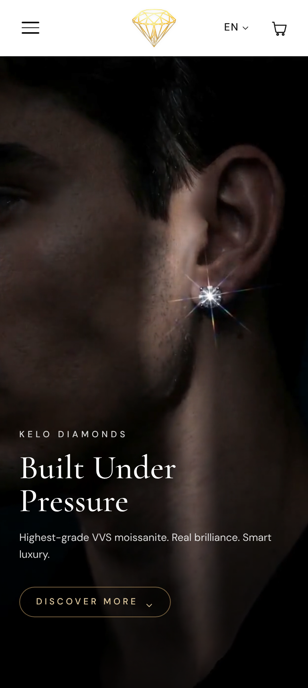</a>

Video de fondo a pantalla completa (primer plano de una oreja con un arete de moissanita), sobre fondo `#050505`; la sección mide 786 px. Abajo a la izquierda:
- Eyebrow "KELO DIAMONDS" (DM Sans 11 px/500, tracking 3.74 px, blanco al 85 %)
- H1 "Built Under Pressure" (Cormorant 41.6 px/500, blanco)
- Subtítulo "Highest-grade VVS moissanite. Real brilliance. Smart luxury." (13 px, blanco al 85 %)
- Botón dorado "DISCOVER MORE ⌄" (189×39). **Al tocarlo:** hace scroll suave hasta el producto estrella (#flagship, scrollY ≈ 948).

**02 — [`02-header.png`](screenshots/02-header.png) — Header / barra de menú**

<a href="screenshots/02-header.png">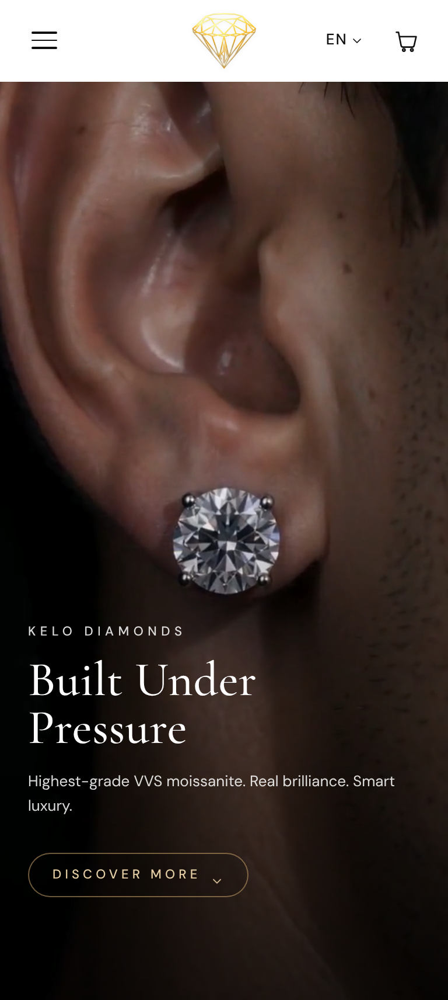</a>

Barra blanca de 70 px:
- ☰ abre el menú (`aria-controls="mobile-menu"`)
- Logo: vuelve al inicio
- "EN ⌄" abre el popover de idioma (pantalla 34)
- 🛒 abre el drawer del carrito (pantalla 36)

**03 — [`03-trust-bar.png`](screenshots/03-trust-bar.png) — Barra de confianza**

<a href="screenshots/03-trust-bar.png">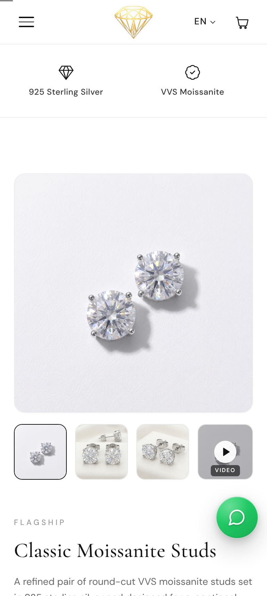</a>

Fondo blanco con `border-bottom` `#eeeeee`, 105 px de alto. Cinco ítems con ícono: 925 Sterling Silver · VVS Moissanite · Sold as a Complete Pair · Premium Gift Box · Personalized Support (DM Sans 16 px/400, `#111`). En 384 px solo se ven 2 ítems a la vez (carrusel o tira horizontal). No es tappable.

**04–06 — [`04-flagship-1.png`](screenshots/04-flagship-1.png) · [`05-flagship-2.png`](screenshots/05-flagship-2.png) · [`06-flagship-3.png`](screenshots/06-flagship-3.png) — Producto estrella "Classic Moissanite Studs"**

 <a href="screenshots/05-flagship-2.png">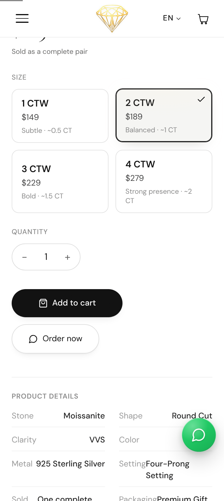</a> <a href="screenshots/06-flagship-3.png">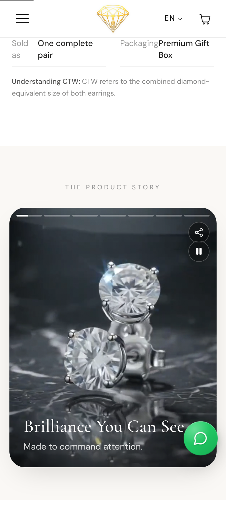</a>

Fondo `#ffffff`, padding 80 px arriba y abajo, 1744 px de alto.
- Imagen principal con 4 miniaturas (75×79, radio 12 px; la activa lleva borde `#111` y las demás `#e8e8e8`). La 4.ª es "VIDEO". **Tocar una miniatura** cambia la imagen o reproduce el video sin navegar.
- Eyebrow "FLAGSHIP" (11 px, `#999`), H2 de 30 px, descripción de 14 px `#666`, precio "$189 USD".
- **SIZE:** 4 tarjetas de 164 px de ancho (1 CTW $149 · 2 CTW $189 [seleccionada por defecto] · 3 CTW $229 · 4 CTW $279). **Al tocar una**, cambia el precio (medido: 1 CTW → $149).
- **QUANTITY:** botones −/+ (41×44, `#666`, 18 px). **"+"** sube la cantidad (medido: 1 → 2).
- "Add to cart" (primario, 188×48): agrega el producto y **abre el drawer del carrito**.
- "Order now" (outline, 149×50): **abre WhatsApp** (`window.open` a `wa.me/5189868583`) con el pedido prellenado (producto, talla, cantidad, precio unitario y total).
- Tabla "PRODUCT DETAILS" (h3 de 12 px/600, `#888`, uppercase): Stone, Shape, Clarity, Color, Metal, Setting, Sold as, Packaging. Debajo, una nota sobre qué significa CTW.

**07 — [`07-story.png`](screenshots/07-story.png) — "The Product Story" (carrusel tipo stories)**

<a href="screenshots/07-story.png">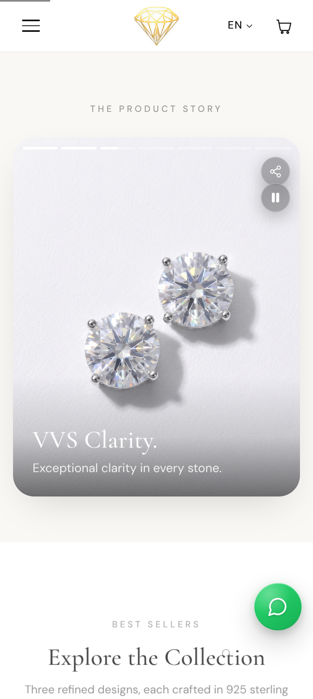</a>

Fondo `#faf8f5`, padding de 56 px. Tarjeta vertical con barras de progreso arriba y título en Cormorant 30.4 px blanco (p. ej. "VVS Clarity.", "Brilliance You Can See."). Controles:
- Share y Pause (36×36, círculo negro al 30 % con borde blanco al 25 %). **Share** cambia `aria-expanded` de false a true (el contenido que despliega no se midió). **Pause** pausa el avance.
- Mitad izquierda y mitad derecha invisibles ("Previous/Next story", 116×356): cambian de story y actualizan la URL (`?story=N`).

**08–10 — [`08-collection-1.png`](screenshots/08-collection-1.png) · [`09-collection-2.png`](screenshots/09-collection-2.png) · [`10-collection-3.png`](screenshots/10-collection-3.png) — Best Sellers / "Explore the Collection"**

<a href="screenshots/08-collection-1.png">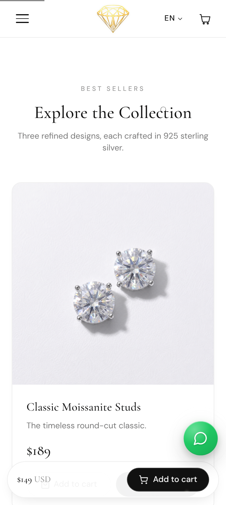</a> <a href="screenshots/09-collection-2.png">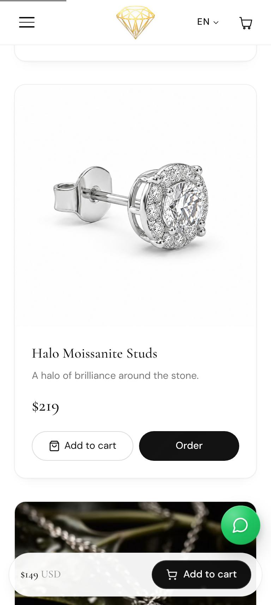</a> <a href="screenshots/10-collection-3.png">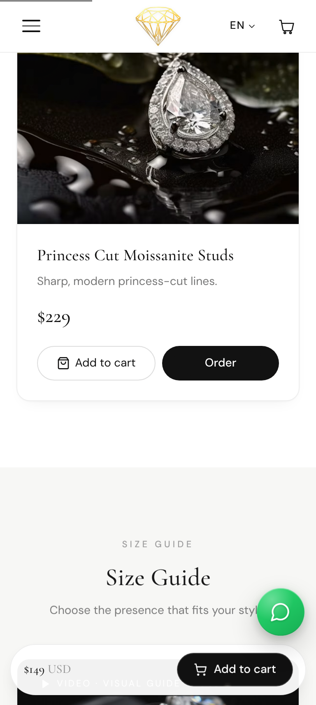</a>

Fondo blanco, 2070 px de alto. Eyebrow "BEST SELLERS", H2 de 30 px, subtítulo de 14 px `#777`. Tres tarjetas (Classic $189, Halo $219, Princess Cut $229):
- La imagen (339×339, fondo `#f7f7f5`) y el nombre (Cormorant 20 px) son enlaces a `/products/classic-studs`, `/products/halo-studs` y `/products/princess-studs`.
- "Add to cart" (outline, 143×42; testid `collection-view-*`): **abre el drawer del carrito con el producto agregado**.
- "Order" (primario, 141×42): **abre WhatsApp** con el pedido prellenado.

**11–12 — [`11-size-guide-1.png`](screenshots/11-size-guide-1.png) · [`12-size-guide-2.png`](screenshots/12-size-guide-2.png) — Guía de tallas**

<a href="screenshots/11-size-guide-1.png">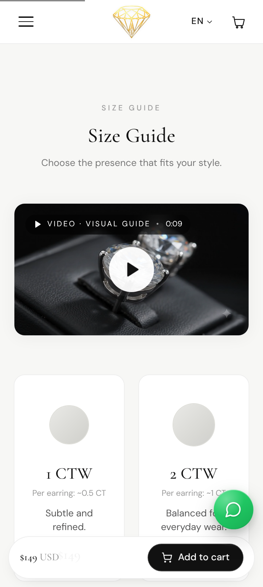</a> <a href="screenshots/12-size-guide-2.png">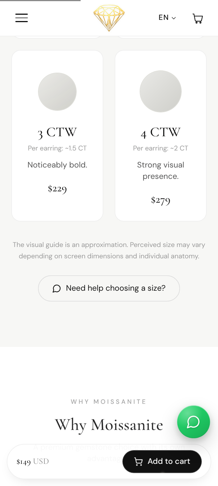</a>

Fondo `#f7f7f5`. Eyebrow "SIZE GUIDE", H2 "Size Guide".
- Video "VIDEO · VISUAL GUIDE · 0:09" (340×191). Al tocarlo no navega ni abre un modal; la reproducción en el mismo lugar no la verifiqué.
- 4 tarjetas blancas con un círculo gris proporcional al tamaño (1–4 CTW: quilates por arete, descripción y precio). No son tappables.
- Nota de aproximación en gris.
- Botón outline "Need help choosing a size?" (248×46, radio 9999): **enlace a WhatsApp** con un mensaje de ayuda para elegir talla.

**13–14 — [`13-why-1.png`](screenshots/13-why-1.png) · [`14-why-2.png`](screenshots/14-why-2.png) — Why Moissanite**

<a href="screenshots/13-why-1.png">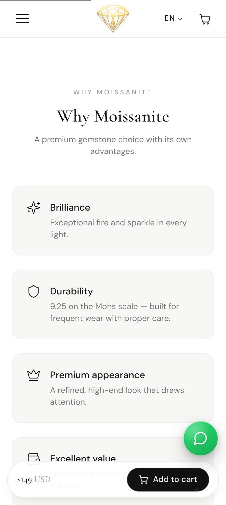</a> <a href="screenshots/14-why-2.png">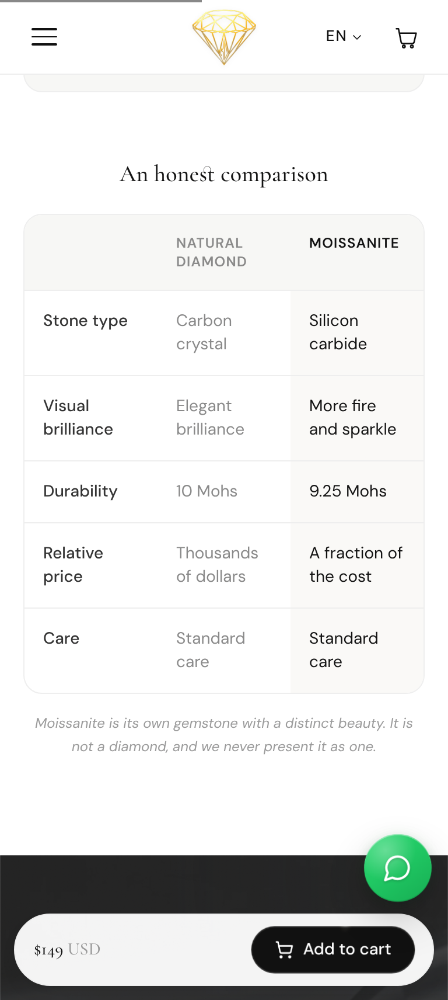</a>

Fondo blanco. Cuatro tarjetas grises con ícono: Brilliance, Durability, Premium appearance, Excellent value (h3 DM Sans 16 px/500). Debajo, la tabla "An honest comparison" entre diamante natural y moissanita (5 filas) y un disclaimer en itálica. Sin elementos tappables.

**15 — [`15-macro.png`](screenshots/15-macro.png) — "Every Detail Matters."**

<a href="screenshots/15-macro.png">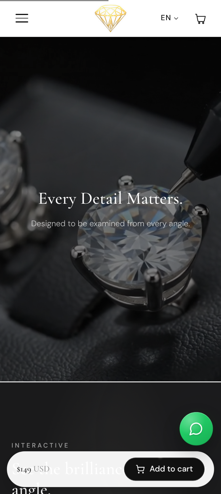</a>

Video macro de un engaste sobre `#050505`, padding de 96 px, `min-h` del 70 % del viewport. H2 blanco de 30 px y subtítulo de 14 px/300 en blanco al 70 %. Sin interacción.

**16–17 — [`16-diamond-3d-1.png`](screenshots/16-diamond-3d-1.png) · [`17-diamond-3d-2.png`](screenshots/17-diamond-3d-2.png) — Diamante 3D interactivo**

<a href="screenshots/16-diamond-3d-1.png">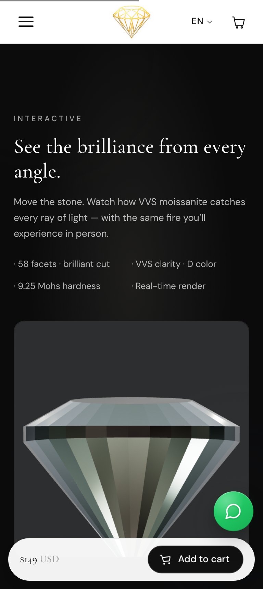</a> <a href="screenshots/17-diamond-3d-2.png">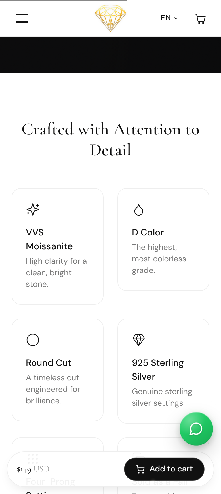</a>

Fondo `#0a0a0b`. Eyebrow "INTERACTIVE" (blanco al 60 %), H2 "See the brilliance from every angle.", texto en blanco al 70 % y una lista de specs (58 facets, VVS, D color, 9.25 Mohs, real-time render). Canvas 3D: el diamante se gira arrastrando o tocando. El efecto exacto del gesto **(no medido)**.

**18–19 — [`18-quality-1.png`](screenshots/18-quality-1.png) · [`19-quality-2.png`](screenshots/19-quality-2.png) — "Crafted with Attention to Detail"**

<a href="screenshots/18-quality-1.png">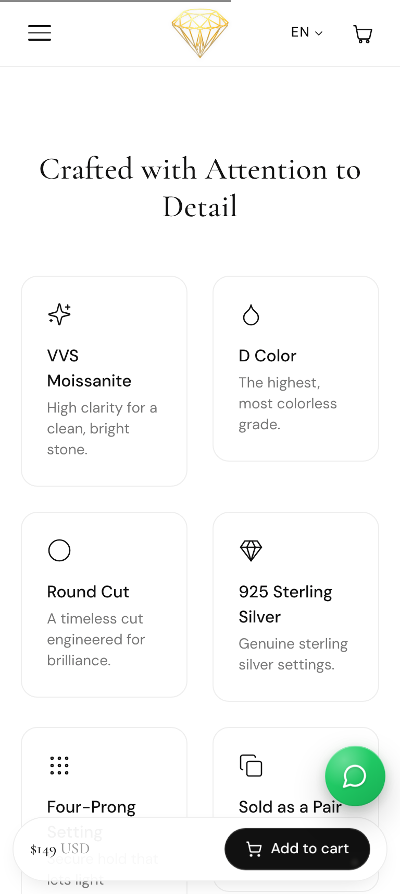</a> <a href="screenshots/19-quality-2.png">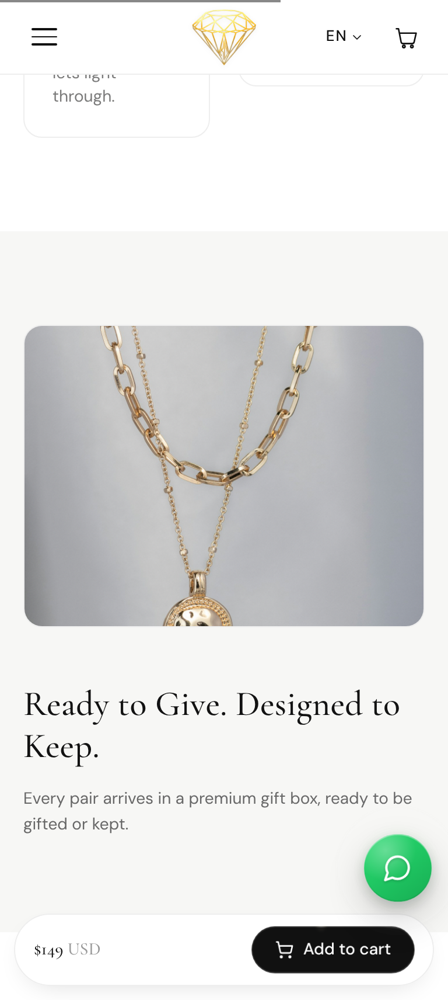</a>

Fondo blanco. Grilla de 2 columnas con 6 tarjetas de borde fino: VVS Moissanite, D Color, Round Cut, 925 Sterling Silver, Four-Prong Setting, Sold as a Pair. Sin interacción.

**20 — [`20-packaging.png`](screenshots/20-packaging.png) — Empaque**

<a href="screenshots/20-packaging.png">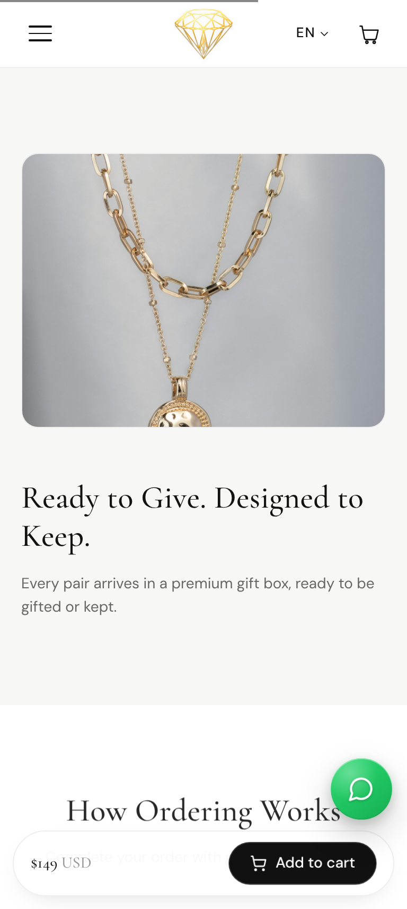</a>

Fondo `#f7f7f5`. Foto de producto con radio grande, H2 "Ready to Give. Designed to Keep." y texto de 14 px `#666`. Sin interacción.

**21–22 — [`21-how-order-1.png`](screenshots/21-how-order-1.png) · [`22-how-order-2.png`](screenshots/22-how-order-2.png) — How Ordering Works**

 <a href="screenshots/22-how-order-2.png">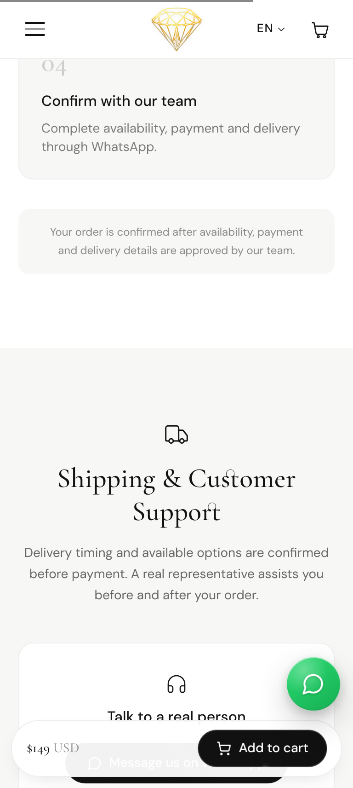</a>

Fondo blanco. Cuatro pasos en tarjetas grises con número grande en serif claro (01–04): Choose your style, Select your size, Send your order, Confirm with our team. Al final, una nota en una caja gris. Sin interacción.

**23 — [`23-shipping.png`](screenshots/23-shipping.png) — Shipping & Customer Support**

<a href="screenshots/23-shipping.png">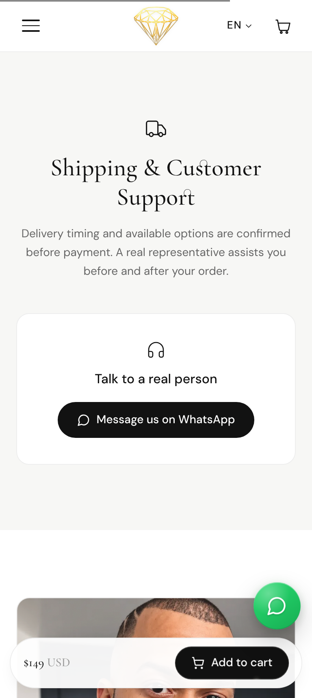</a>

Fondo `#f7f7f5`, ícono de camión, H2 y texto. Tarjeta blanca "Talk to a real person" con el botón primario "Message us on WhatsApp" (241×44), que es un **enlace a WhatsApp**.

**24–25 — [`24-founder-1.png`](screenshots/24-founder-1.png) · [`25-founder-2.png`](screenshots/25-founder-2.png) — Our Story / fundador**

<a href="screenshots/24-founder-1.png">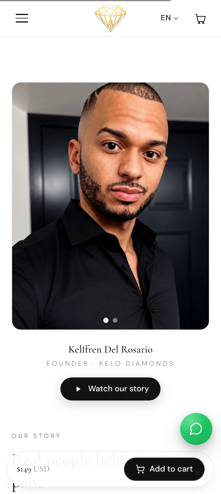</a> <a href="screenshots/25-founder-2.png">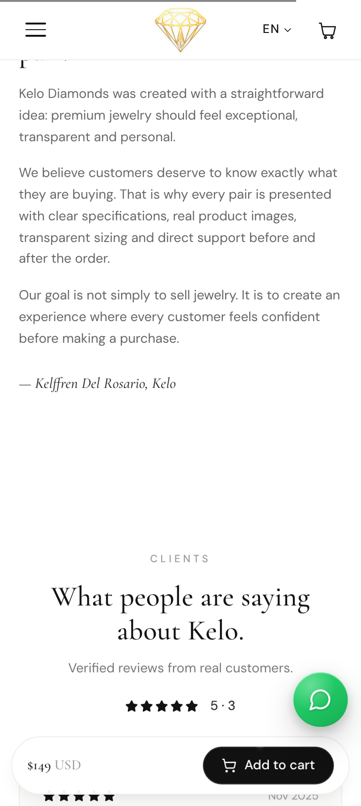</a>

Fondo blanco. Retrato de Kelffren Del Rosario con 2 dots (Show photo / Show video). Nombre en serif y "FOUNDER · KELO DIAMONDS" (12 px, tracking 2.88 px, `#999`). Botón primario "▶ Watch our story" (172×40): no navega ni abre un modal; la reproducción del video no la verifiqué. Luego el eyebrow "OUR STORY", el H2 "Real people behind every pair." y tres párrafos firmados.

**26–27 — [`26-reviews-1.png`](screenshots/26-reviews-1.png) · [`27-reviews-2.png`](screenshots/27-reviews-2.png) — Testimonios**

<a href="screenshots/26-reviews-1.png">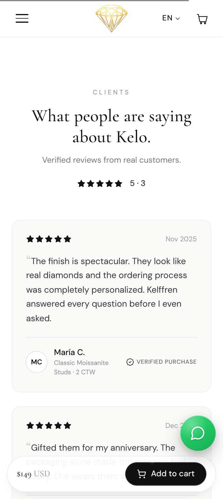</a> <a href="screenshots/27-reviews-2.png">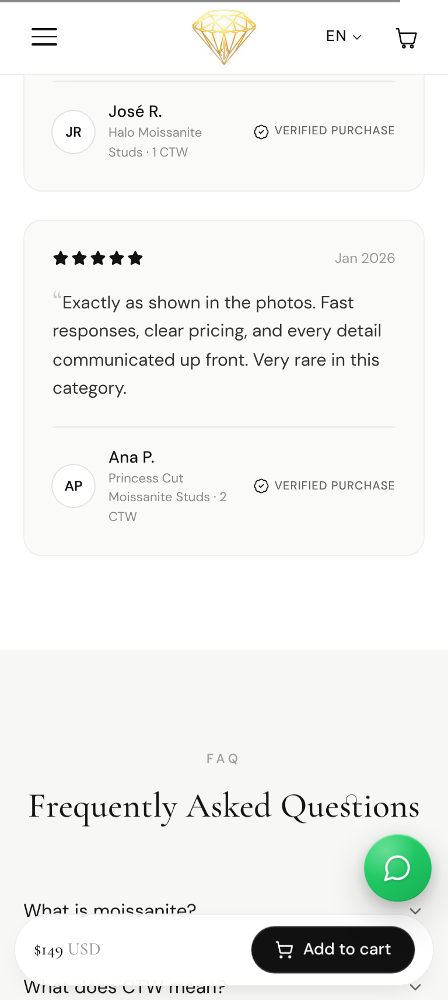</a>

Fondo blanco. Eyebrow "CLIENTS", H2 "What people are saying about Kelo.", ★★★★★ 5·3. Tres tarjetas grises con estrellas, fecha, cita, avatar con iniciales (MC, JR, AP), nombre, producto/talla (11 px `#888`) y la etiqueta "✓ VERIFIED PURCHASE". Sin interacción.

**28–29 — [`28-faq-1.png`](screenshots/28-faq-1.png) · [`29-faq-2.png`](screenshots/29-faq-2.png) — Preguntas frecuentes**

<a href="screenshots/28-faq-1.png">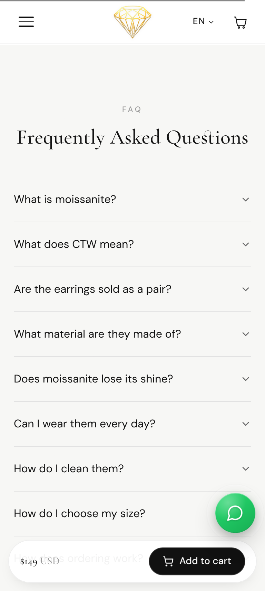</a> <a href="screenshots/29-faq-2.png">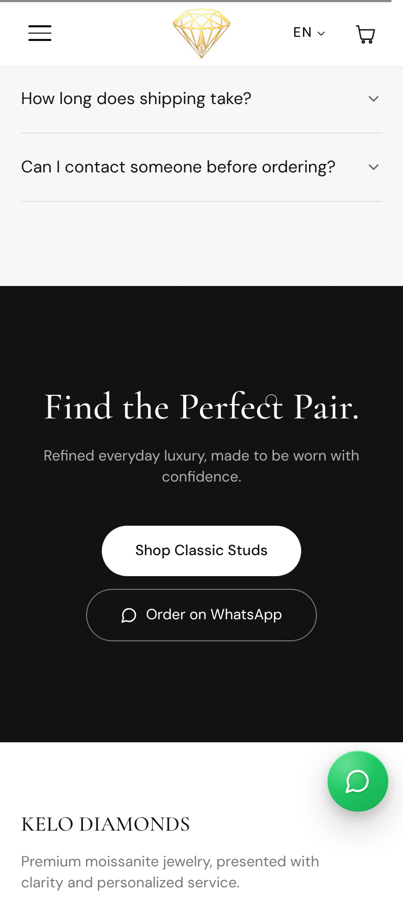</a>

Fondo `#f7f7f5`. Acordeón con 11 preguntas (botones de 342×64, padding 20 px arriba y abajo, DM Sans 16 px, chevron a la derecha, divisores finos). **Al tocar una**, se expande la respuesta (`aria-expanded` pasa de false a true; medido en "What is moissanite?").

**30 — [`30-final-cta.png`](screenshots/30-final-cta.png) — CTA final**

<a href="screenshots/30-final-cta.png">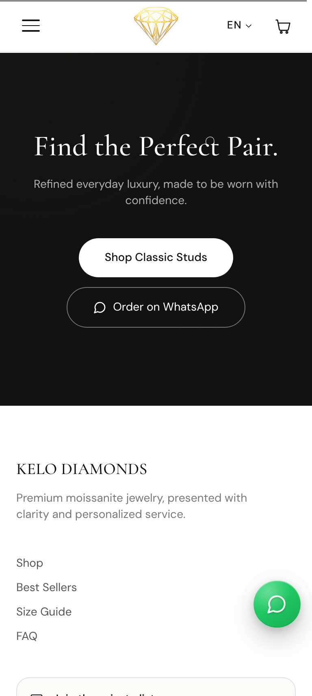</a>

Fondo `#111111`, padding de 96 px. H2 blanco de 36 px "Find the Perfect Pair." y texto blanco al 65 %.
- "Shop Classic Studs" (píldora blanca, 188×48): **scroll al flagship**.
- "Order on WhatsApp" (outline blanco): **abre WhatsApp** con el pedido prellenado.

**31 — [`31-footer.png`](screenshots/31-footer.png) — Footer**

<a href="screenshots/31-footer.png">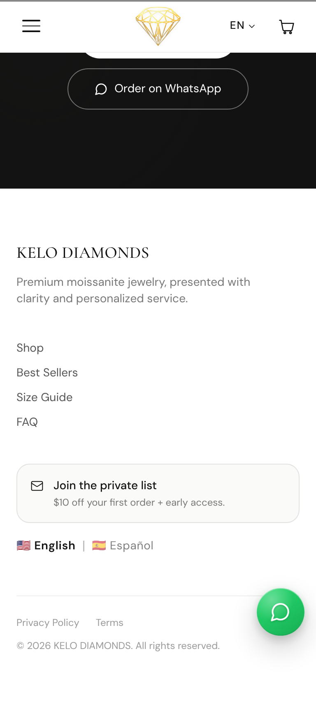</a>

Fondo blanco.
- "KELO DIAMONDS" (Cormorant 20 px) y una descripción.
- Links Shop / Best Sellers / Size Guide / FAQ (14 px `#555`): **hacen scroll a su sección** (FAQ medido → #faq).
- Tarjeta "Join the private list · $10 off your first order + early access" (fondo `#fafaf8`, borde `#e2e2e0`, radio 16 px): **abre el modal de descuento** (pantalla 32).
- Toggle de idioma 🇺🇸 English | 🇪🇸 Español (14 px; el idioma activo va en 600).
- "Privacy Policy" y "Terms" (12 px `#999`) tienen `href="#"`: **solo regresan al tope; no hay páginas legales**.
- © 2026.

**32 — [`32-popup-descuento.png`](screenshots/32-popup-descuento.png) — Modal de captación "$10 off"**

<a href="screenshots/32-popup-descuento.png">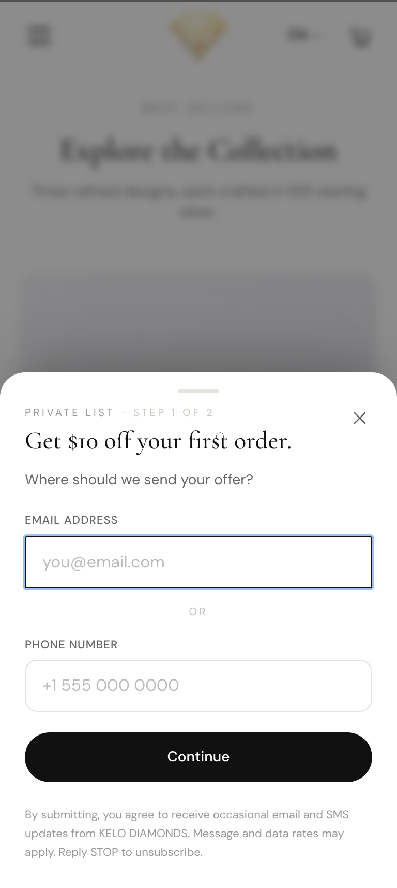</a>

Aparece solo, tras unos 10 pasos de scroll (alrededor de 3000 px). Es un bottom sheet blanco con esquinas superiores de 24 px de radio sobre un backdrop negro al 45 % con blur.
- Eyebrow "PRIVATE LIST · STEP 1 OF 2", título de 24 px "Get $10 off your first order."
- Inputs de email y teléfono (50 px de alto, 16 px, padding 12×16, borde `#e2e2e0`, radio 12 px; con foco, el borde pasa a `#111`).
- "Continue" (primario de ancho completo, 336×48): por el indicador "Step 1 of 2" debería llevar a un paso 2 **(no probado; no se envió nada)**.
- ✕ (40×40) cierra el modal.
- Disclaimer SMS de 11 px `#999`.

**33 — [`33-popup-salida.png`](screenshots/33-popup-salida.png) — Modal de salida "Wait… before you go."**

<a href="screenshots/33-popup-salida.png">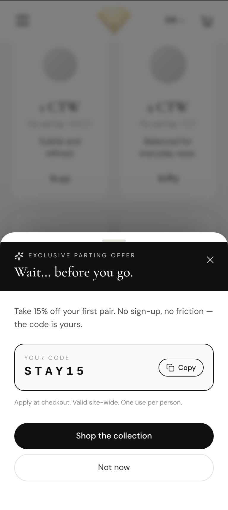</a>

Aparece al volver rápido al tope (exit intent). Header negro con "EXCLUSIVE PARTING OFFER" y el título en blanco. Debajo, el texto "Take 15% off your first pair" y la caja del código **STAY15** con el botón "Copy" (outline, 76×30) **(acción no probada)**. Botones:
- "Shop the collection" (primario, 336×44) **(destino no medido)**.
- "Not now" (outline): cierra.
- ✕: cierra.

**34 — [`34-selector-idioma.png`](screenshots/34-selector-idioma.png) — Popover de idioma**

<a href="screenshots/34-selector-idioma.png">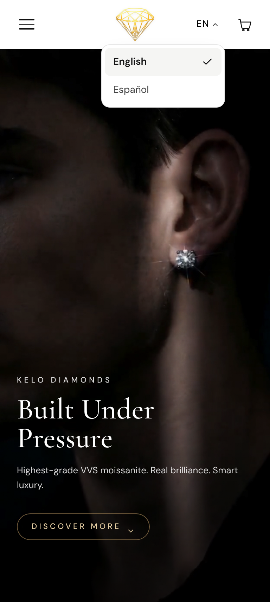</a>

Desplegable blanco bajo "EN ⌃" con English ✓ (fondo `#f5f5f3`, 14 px/600) y Español (`#444`, 400); ítems de 166×40 con radio 8 px. **Tocar "Español"** traduce la página al instante, sin recargar ni cambiar la URL, y la preferencia **persiste al recargar**.

**35 — [`35-menu-hamburguesa.png`](screenshots/35-menu-hamburguesa.png) — Menú hamburguesa abierto**

<a href="screenshots/35-menu-hamburguesa.png">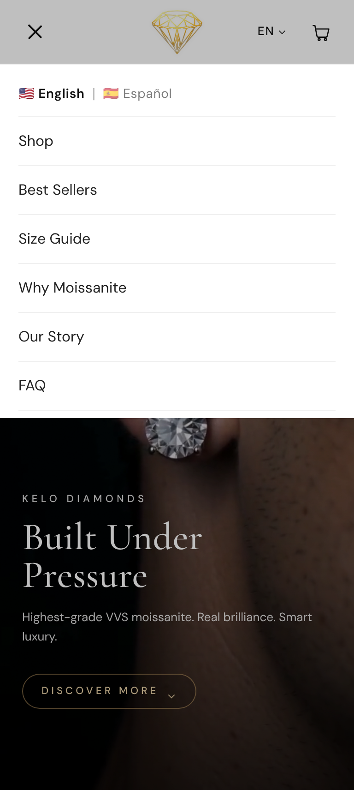</a>

El ☰ se convierte en ✕ y el panel blanco baja desde el header sobre un overlay negro al 25 %. Arriba va el toggle "🇺🇸 English | 🇪🇸 Español". Luego, 6 ítems (344×53, DM Sans 16 px, `#222`, separadores `#f0f0f0`). Cada ítem cierra el menú y hace scroll a su sección (medido):

| Ítem | Destino |
|---|---|
| Shop | #flagship (scrollY ≈ 926) |
| Best Sellers | #collection (≈ 3278) |
| Size Guide | #size-guide (≈ 5335) |
| Why Moissanite | #why-moissanite (≈ 6672) |
| Our Story | #our-story (≈ 12754) |
| FAQ | #faq (≈ 15227) |

No hay submenús.

**36 — [`36-carrito-vacio.png`](screenshots/36-carrito-vacio.png) — Carrito vacío**

<a href="screenshots/36-carrito-vacio.png">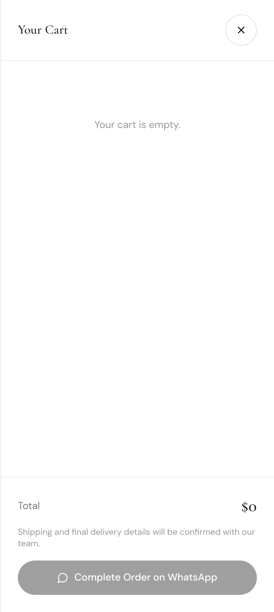</a>

Drawer lateral de ancho completo y fondo blanco. Título "Your Cart" (Cormorant 18 px), ✕ (círculo de 44×44 con borde `#e2e2e2`) y el texto "Your cart is empty." centrado en gris. Abajo: Total $0, nota de envío de 12 px `#999` y "Complete Order on WhatsApp" **deshabilitado** (gris).

**37 — [`37-tienda.png`](screenshots/37-tienda.png) — "Tienda" / Shop**

<a href="screenshots/37-tienda.png">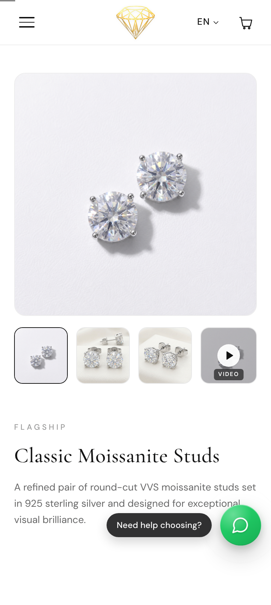</a>

El sitio **no tiene una página de tienda aparte**: "Shop" (en el menú y el footer) hace scroll a la sección del producto estrella. `/shop`, `/cart` y `/es` responden 200 pero **renderizan una pantalla en blanco** (no hay página 404 ni redirección). La captura muestra el destino real de "Shop": #flagship.

**38 — [`38-carrito-con-producto.png`](screenshots/38-carrito-con-producto.png) — Carrito con 1 producto**

<a href="screenshots/38-carrito-con-producto.png">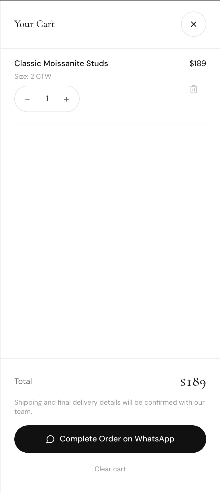</a>

Línea "Classic Moissanite Studs · Size: 2 CTW · $189", con el selector − 1 + (44×44) y un ícono de papelera para quitar (`#bbb`). Total $189, botón negro activo "Complete Order on WhatsApp" (335×48, radio 9999) y el link "Clear cart" (12 px `#999`).
**Al tocar Checkout:** abre `wa.me/5189868583` con el pedido completo prellenado: producto, talla, cantidad, precio unitario, total y la petición de confirmar disponibilidad, pago y entrega. No hay pasarela de pago.

**39–42 — [`39-producto-classic-studs-1.png`](screenshots/39-producto-classic-studs-1.png) · [`40-producto-classic-studs-2.png`](screenshots/40-producto-classic-studs-2.png) · [`41-producto-classic-studs-3.png`](screenshots/41-producto-classic-studs-3.png) · [`42-producto-classic-studs-4.png`](screenshots/42-producto-classic-studs-4.png) — Página de producto `/products/classic-studs`**

<a href="screenshots/39-producto-classic-studs-1.png">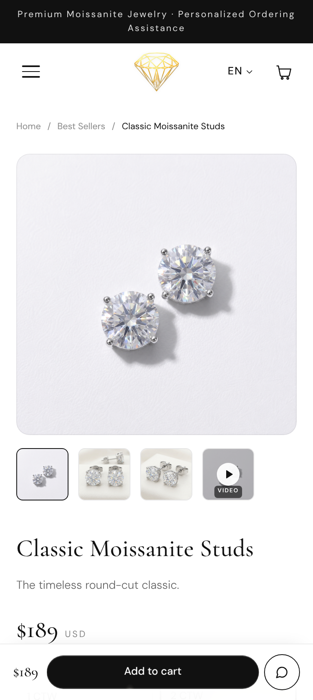</a> <a href="screenshots/40-producto-classic-studs-2.png">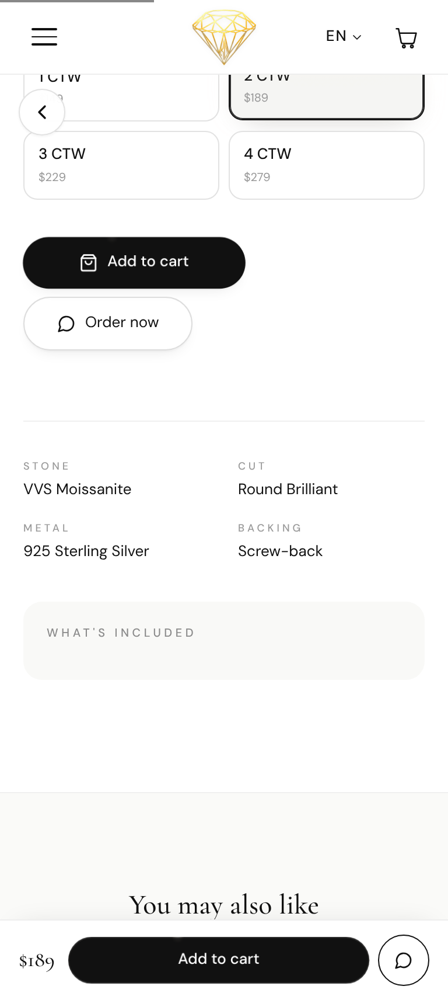</a>  <a href="screenshots/42-producto-classic-studs-4.png">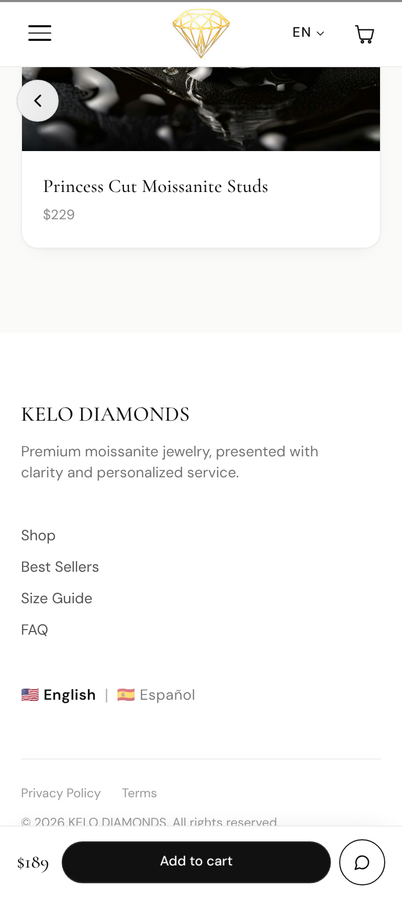</a>

- Barra de anuncio negra (`#111`, 53 px): "Premium Moissanite Jewelry · Personalized Ordering Assistance" (11 px, blanco al 85 %).
- Header y breadcrumb "Home / Best Sellers / Classic Moissanite Studs" (11 px `#8a8a8a`; enlaces a `/` y `/#collection`).
- Galería con 4 miniaturas de 64×64 (radio 8).
- H1 en Cormorant 30 px y subtítulo de 14 px/300.
- Precio "$189 USD".
- Tallas en tarjetas de 168×59 (radio 12).
- "Add to cart" (192×44) y "Order now" (outline, abre WhatsApp).
- Specs: Stone / Cut / Metal / Backing (Screw-back) y una caja "WHAT'S INCLUDED".
- "You may also like": tarjetas de Halo y Princess (344×436, borde `#eee`, radio 16) que enlazan a sus páginas.
- Botón "←" (40×40, blanco al 90 %): vuelve atrás.
- Barra inferior sticky: "$189", "Add to cart" (259×40) y un botón de WhatsApp (círculo de 44×44 con borde `#111`).

**43 — [`43-pagina-completa.png`](screenshots/43-pagina-completa.png) — Página completa (EN)**

Captura full-page del home: 17 323 px de alto, todas las secciones en orden.

### Español

El cambio se hizo con el selector "EN ⌄" → "Español". `<html lang>` pasa a `es` y la URL sigue siendo `/`. El diseño, los colores, las tipografías y el espaciado son **idénticos** a la versión en inglés. Solo cambian los textos, y algunas secciones crecen un poco de alto (el flagship baja de 1744 a 1708 px; la colección sube de 2070 a 2130 px).

| # | Archivo | Pantalla (equivale a) | Notas de la versión ES |
|---|---|---|---|
| 44 | <a href="screenshots/44-es-hero.png">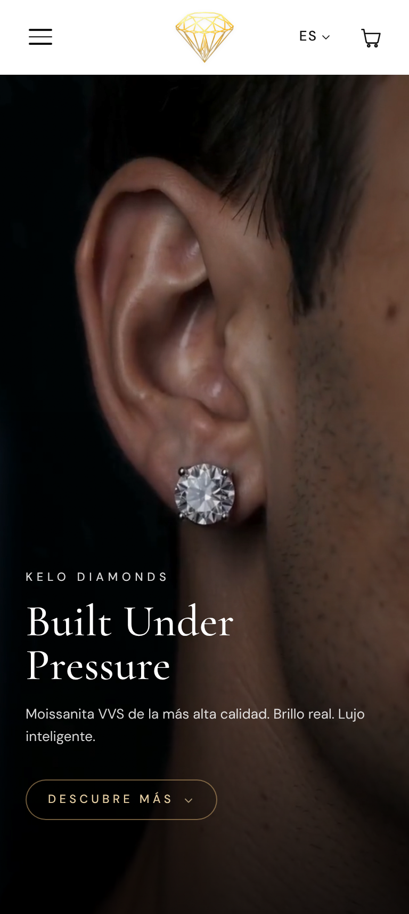</a> | Hero (01) | ⚠️ El H1 **"Built Under Pressure" sigue en inglés**. Subtítulo: "Moissanita VVS de la más alta calidad. Brillo real. Lujo inteligente." CTA: "DESCUBRE MÁS". |
| 45 | <a href="screenshots/45-es-header.png">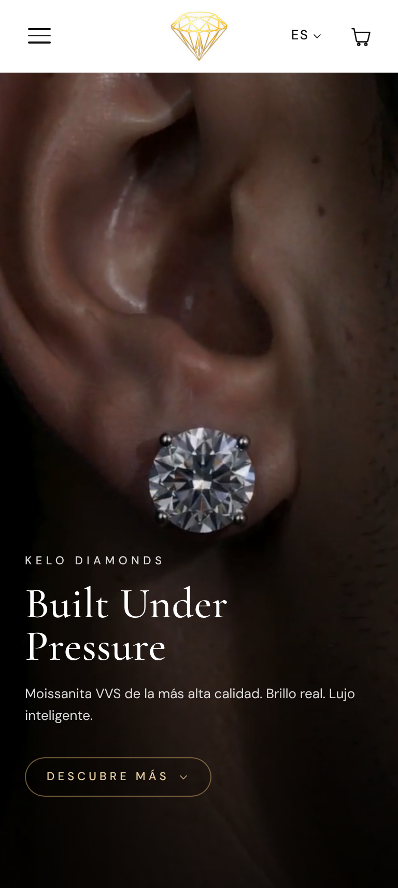</a> | Header (02) | Muestra "ES ⌄". |
| 46 | <a href="screenshots/46-es-trust-bar.png">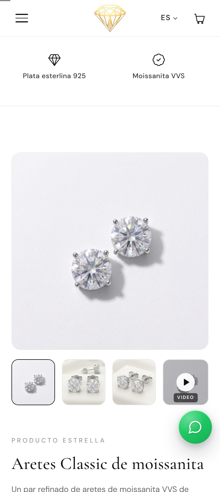</a> | Trust bar (03) | "Plata esterlina 925 · Moissanita VVS · Se vende como un par completo · Caja de regalo premium · Atención personalizada"; la barra pasa a 121 px de alto. |
| 47–49 | <a href="screenshots/47-es-flagship-1.png">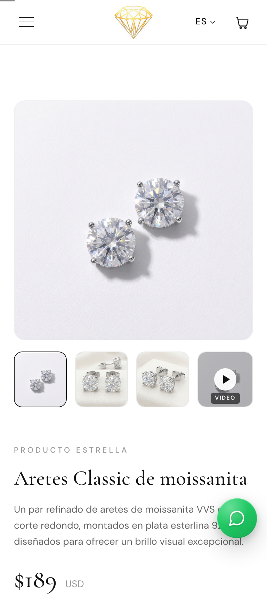</a> <a href="screenshots/48-es-flagship-2.png">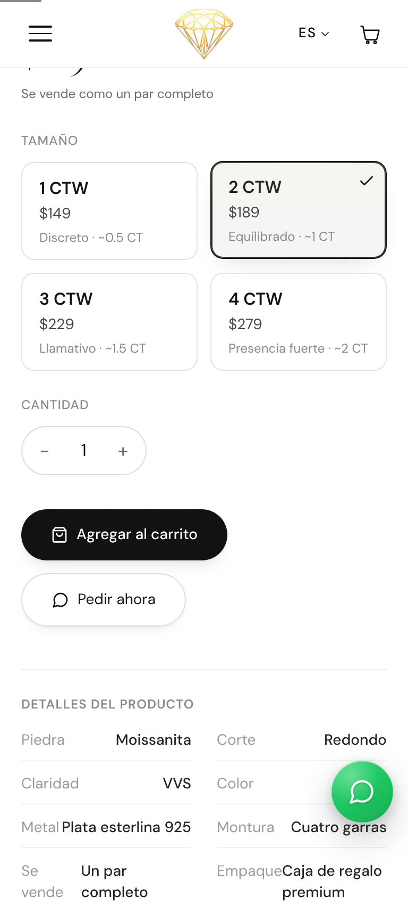</a> <a href="screenshots/49-es-flagship-3.png">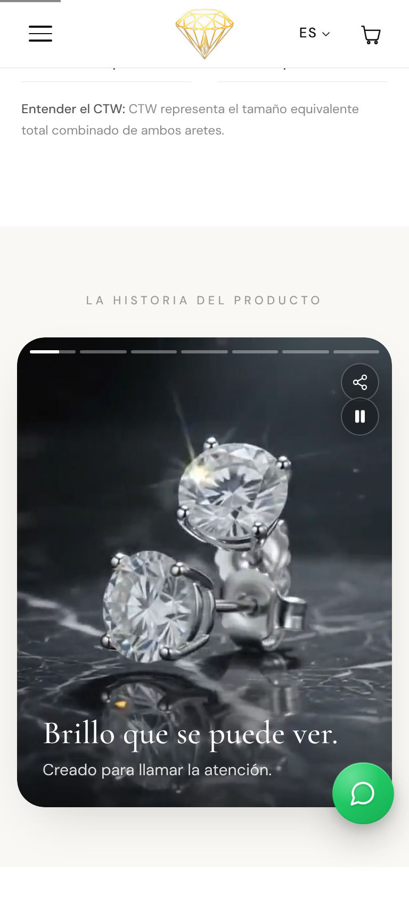</a> | Flagship (04–06) | "PRODUCTO ESTRELLA", "Aretes Classic de moissanita", "TAMAÑO" (Discreto / Equilibrado / Llamativo / Presencia fuerte), "CANTIDAD", "Agregar al carrito", "Pedir ahora", "DETALLES DEL PRODUCTO". |
| 50 | <a href="screenshots/50-es-story.png">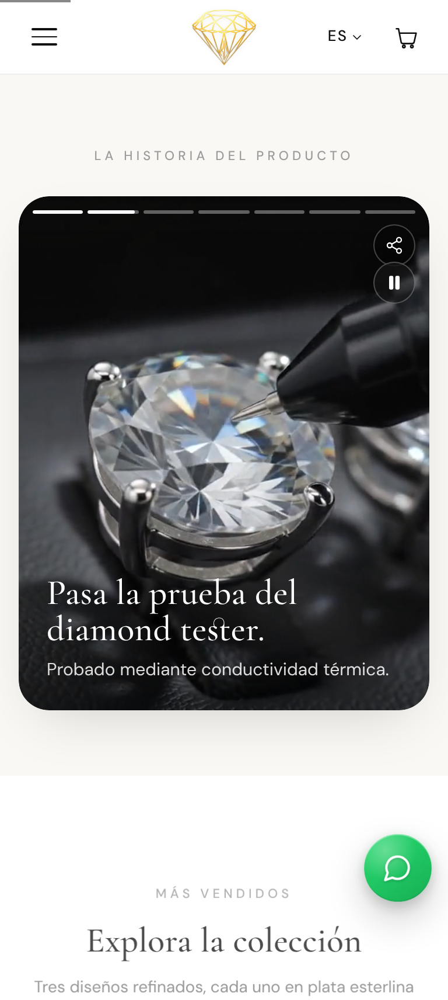</a> | Story (07) | "LA HISTORIA DEL PRODUCTO"; stories como "Brillo que se puede ver." y "Pasa la prueba del diamond tester." |
| 51–53 | <a href="screenshots/51-es-collection-1.png">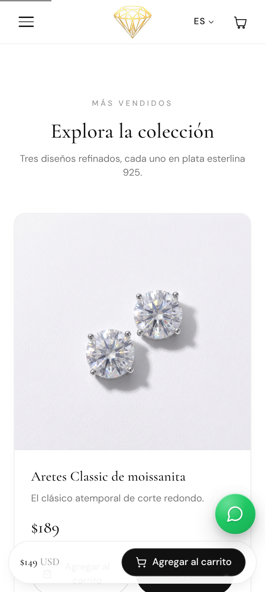</a> <a href="screenshots/52-es-collection-2.png">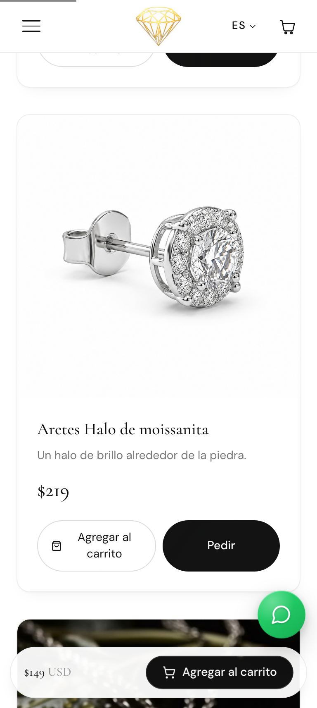</a> <a href="screenshots/53-es-collection-3.png">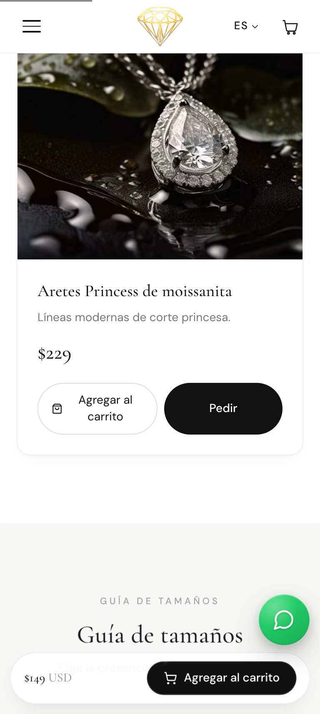</a> | Colección (08–10) | "MÁS VENDIDOS · Explora la colección"; botones "Agregar al carrito" y "Pedir". |
| 54–55 | <a href="screenshots/54-es-size-guide-1.png">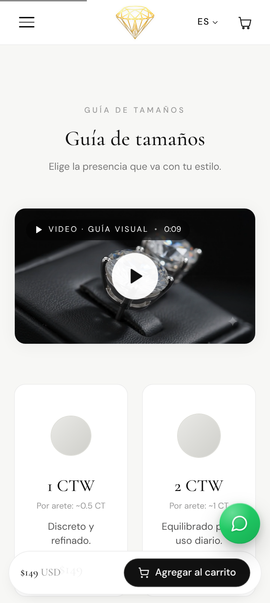</a>  | Guía de tallas (11–12) | "Guía de tamaños". |
| 56–57 |   | Why (13–14) | "Por qué moissanita": Brillo, Durabilidad, Apariencia premium… |
| 58 |  | Macro (15) | "Cada detalle importa." |
| 59–60 |   | Diamante 3D (16–17) | ⚠️ El H2 **"See the brilliance from every angle." sigue en inglés**. |
| 61–62 |   | Calidad (18–19) | "Elaborado con atención al detalle". |
| 63 |  | Empaque (20) | "Lista para regalar. Diseñada para conservar." |
| 64–65 |   | Cómo pedir (21–22) | "Cómo funciona el pedido": Elige tu estilo, Selecciona tu tamaño, Envía tu pedido… |
| 66 |  | Envío (23) | "Envíos y atención al cliente · Habla con una persona real". |
| 67–68 |   | Fundador (24–25) | "Personas reales detrás de cada par." |
| 69–70 |   | Reseñas (26–27) | "Lo que dicen quienes ya usan Kelo." |
| 71–72 |   | FAQ (28–29) | "Preguntas frecuentes": ¿Qué es la moissanita?, ¿Qué significa CTW?… |
| 73 |  | CTA final (30) | "Encuentra el par perfecto." y "Pedir por WhatsApp". |
| 74 |  | Footer (31) | "Comprar / Más vendidos / Guía de tamaños / Preguntas frecuentes", "Únete a la lista privada", "Política de privacidad / Términos" (siguen con `href="#"`). |
| 75 |  | Modal $10 (32) | "LISTA PRIVADA · PASO 1 DE 2", "Obtén $10 en tu primera compra.", "¿A dónde te envío tu oferta?", placeholder del teléfono "+52 555 000 0000", "Continuar". |
| 76 |  | Popover de idioma (34) | "Español ✓" activo. |
| 77 |  | Menú (35) | Comprar, Más vendidos, Guía de tamaños, Por qué moissanita, Nuestra historia, Preguntas frecuentes. |
| 78 |  | Carrito vacío (36) | "Tu carrito", "Tu carrito está vacío.", "Completar pedido por WhatsApp" (deshabilitado). |
| 79 |  | Tienda (37) | "Comprar" lleva al flagship. |
| 80 |  | Carrito lleno (38) | "Aretes Classic de moissanita · Tamaño: 2 CTW · $189", "Vaciar carrito". El mensaje de WhatsApp sale en español. |
| 81–84 |     | Producto (39–42) | ⚠️ La barra de anuncio superior **sigue en inglés**. Breadcrumb "Inicio / Más vendidos", "Aretes Classic de moissanita", "Agregar al carrito", "Pedir ahora", specs (Piedra, Corte, Metal, Sujeción: Rosca/screw-back), "También te puede gustar". |
| 85 |  | Página completa (43) | 17 453 px de alto. |

El modal de salida (STAY15) no volvió a aparecer en la sesión en español, así que no hay captura ES de esa pantalla.

---

## 3. Hallazgos y observaciones
1. **Precio inconsistente en la barra sticky:** muestra "$149 USD", pero "Add to cart" agrega 2 CTW a $189.
2. **Traducciones incompletas en ES:** el H1 del hero, el H2 del diamante 3D y la barra de anuncio de la página de producto siguen en inglés.
3. **Rutas sin contenido:** `/shop`, `/cart` y `/es` devuelven 200 con la pantalla en blanco. Convendría redirigirlas o mostrar una 404.
4. **Privacy Policy / Terms** apuntan a `#`; no hay páginas legales.
5. **Dos popups de marketing** en la primera visita: el de $10 tras unos 3000 px de scroll y el de salida (15 % con STAY15). En móvil pueden sentirse invasivos.
6. Todo el checkout ocurre por **WhatsApp** (`wa.me/5189868583`), con mensajes prellenados. El botón de checkout se deshabilita con el carrito vacío.
7. El placeholder del teléfono en ES es "+52…" (México), mientras que en EN es "+1…".
8. La mayoría de los tap targets miden 40–48 px o más; los dots del fundador miden **8–9 px**, muy por debajo del mínimo recomendado de 44 px.

## 4. Qué no se midió
- El efecto exacto del gesto de arrastre en el canvas 3D.
- El contenido del paso 2 del modal de descuento: no se envió ningún email ni teléfono.
- Qué abre exactamente el botón Share de las stories, más allá del cambio de `aria-expanded`.
- El color exacto de la burbuja de WhatsApp: viene de un SVG/imagen, no de CSS.
- Se usó Chrome con emulación móvil, no Safari real de iOS.
